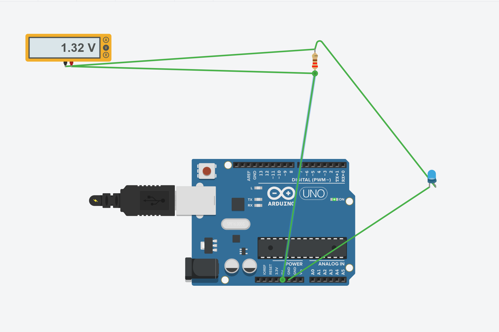

Experiment 01: LED Voltage Measurement

1. Objective（实验目的）

学习使用Tinkercad虚拟万用表测量电压。

验证基尔霍夫电压定律。

使用欧姆定律计算LED工作电流。

2. Components（实验元件）

Arduino Uno

Blue LED × 1

Resistor: 220 Ω

Virtual Multimeter

Simulation Software: Tinkercad Circuits

3. Circuit Design（电路设计）

电路结构：

5V供电端 → 220Ω电阻 → 蓝色LED → GND

注意：Arduino实际使用的供电引脚仍需对照最终电路截图确认。

4. Theoretical Calculation（理论计算）

假设：

电源电压：5V

LED正向电压：3V

电阻：220Ω

电阻两端电压：

U_R = 5 - 3 = 2V

预计电流：

I = 2 / 220 ≈ 9.09mA

## 5. Simulation Results（仿真结果）

| Parameter | Value | Method |
|---|---|---|
| LED Voltage | 3.68 V | Measured |
| Resistor Voltage | 1.32 V | Measured |
| Resistance | 220 Ohm | Component Setting |
| LED Current | 6 mA | Calculated |

6. Analysis（实验分析）

根据基尔霍夫电压定律：

3.68V + 1.32V = 5.00V

测量数据符合串联电路的电压关系。

根据欧姆定律：

I = 1.32 / 220 = 0.006A = 6mA

理论计算采用LED正向压降3V的近似假设，而仿真得到3.68V，因此计算出的实际工作电流与理论预测不同。

7. Conclusion（实验结论）

掌握了使用虚拟万用表测量元件电压的方法。

验证了串联电路的电压关系。

利用电阻压降计算得到LED电流为6mA。

理解了理论近似值与仿真结果之间可能存在差异。

8. Next Steps（下一步）

核对并保存最终电路连接图。

使用Arduino数字引脚控制LED。

继续开发智能灯光控制系统。

## 9. Experiment Screenshot（实验截图）

The following image shows the LED circuit and the
measured voltage across the 220-ohm resistor.

